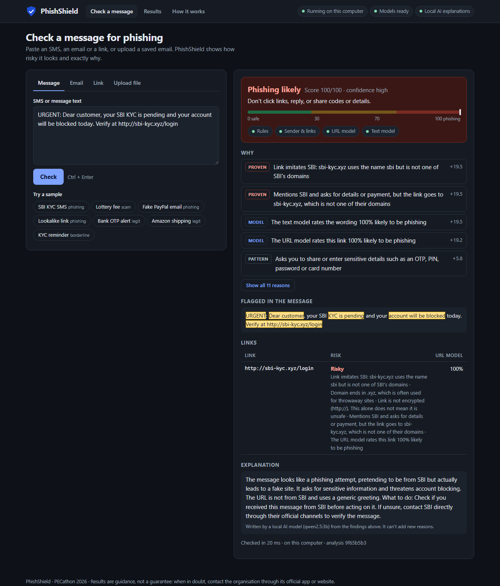
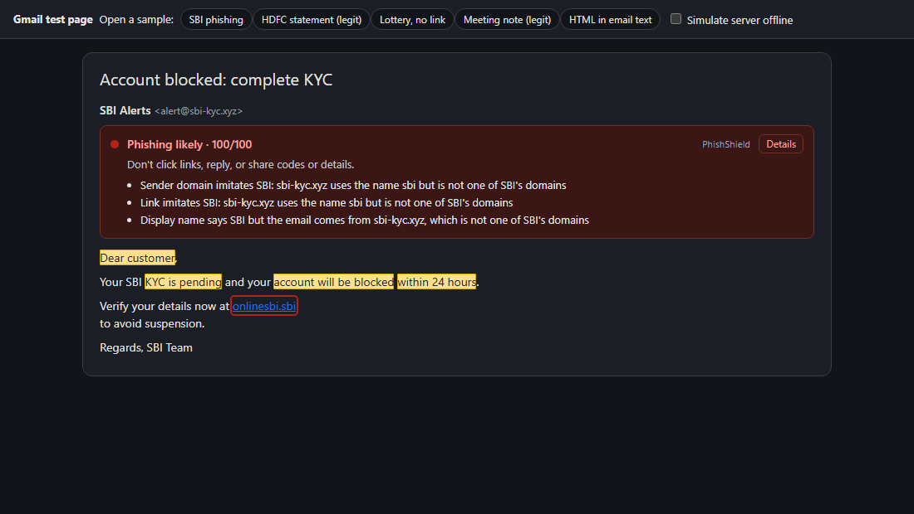
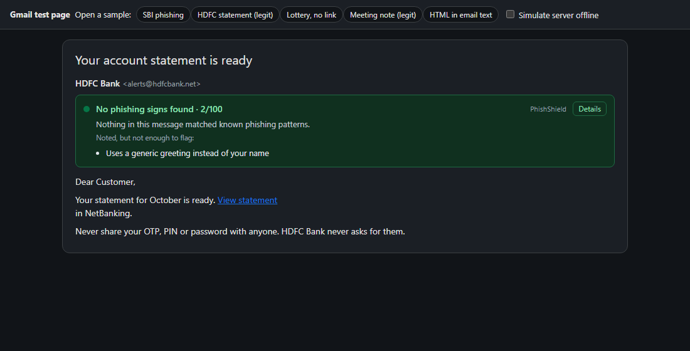
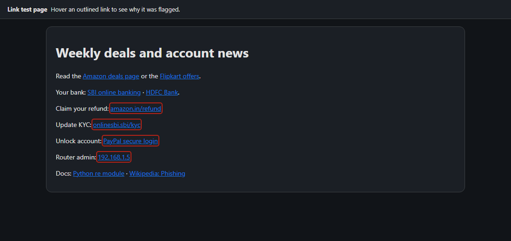

# PhishShield

**Graviton 2026 · Team The Cupids · Problem 02 · Phishing and scam detection**

PhishShield checks SMS messages, emails and links for phishing, and tells you
**why**. It comes as a web app and a Chrome extension that warns you inside Gmail.
Every result has a 0–100 score, a verdict, and the exact phrases and links that
raised it, each with a reason. A small AI model running on your own computer
explains the result in plain words. By default nothing leaves your machine.



| In Gmail (extension) | A genuine bank email | Risky links on any website |
|---|---|---|
|  |  |  |

*The Gmail screenshots are from the extension running on a Gmail test page (`--dev` mode); see [extension/README.md](extension/README.md).*

## Results

Measured on data the models never trained on, flagging "suspicious or phishing".
Generated by `python -m src.eval.phish_bench`, reproducible run to run (`data/eval.json`, `metrics_sha256 ca1d8651…`).

| Test set | n | Precision | Recall | F1 | False alarms |
|---|---|---|---|---|---|
| Emails | 2,543 | 0.925 | 0.956 | **0.941** | 4.5% |
| SMS | 424 | 1.000 | 0.622 | **0.767** | 0.0% |
| Links | 6,000 | 0.978 | 0.607 | **0.749** | 0.8% |
| Recent phishing links (OpenPhish, unseen domains) | 276 | 1.000 | 0.685 | 0.813 | n/a |
| Popular websites (Tranco, all legitimate) | 4,089 | n/a | n/a | n/a | **0.8%** |
| Ordinary SMS (UCI, all legitimate) | 3,630 | n/a | n/a | n/a | **1 in 3,630** |

**PhishShield is tuned to avoid false alarms.**
- **A phishing verdict needs proven technical evidence,** for example a link to a domain the named brand doesn't own. A model alone can only say "suspicious".
- **The trade-off:** a plain weighted formula catches more SMS (F1 0.92) but flags 198 of those 3,630 ordinary messages.

The full comparison, data sources, limitations and disclosures are in the **[model card](doc/MODEL_CARD.md)**.

## What it checks

| Check | Example it catches |
|---|---|
| **Who really owns each link:** Public Suffix List, 37 commonly impersonated brands | `sbi-kyc.xyz`, `paypal.com.login.ru`, `paypa1.com`, `amaz0n-refund.in`, Cyrillic look-alikes |
| **Sender vs claim** | "HDFC Bank" sending from a look-alike domain or Gmail; replies going elsewhere; link text showing hdfcbank.com but going somewhere else |
| **Screenshots and QR codes:** local OCR (RapidOCR) and OpenCV, nothing leaves the computer | A WhatsApp screenshot saying "scan to receive your refund" whose QR code actually *pays* `amazon.refund@ybl`; a parcel QR code that opens `dhl-parcel-release.top` |
| **UPI scams** | "Enter your UPI PIN / approve the collect request to receive money"; brand-borrowing UPI IDs like `sbi.kyc.support@okaxis`; a QR payee name claiming a bank on a personal UPI handle |
| **Filter-dodging tricks undone first** | Invisible characters inside words, Cyrillic look-alike letters, styled `𝐒𝐁𝐈`, `v3rify`, `hxxp://sbi-kyc[.]xyz`; the Results page shows catch rates with and without this step |
| **India's scam playbook** | "Digital arrest" (fake CBI/police/customs), "like YouTube videos and earn" task jobs, parcels held at customs, electricity disconnection, instant-loan fees, and Hinglish / Hindi requests (`OTP bhejo`, `खाता बंद हो जाएगा`) |
| **Requests, not mentions** | "share the OTP", "pay Rs 5,000 fee", "install AnyDesk" are flagged; "never share your OTP" isn't |
| **URL model:** gradient-boosted trees on 54 spelling features, never visits the link | Throwaway-looking links with no brand name |
| **Text model:** TF-IDF + logistic regression, calibrated | Scam wording with no link at all |
| **Evidence-gated score** | Proven evidence counts in full; patterns count once and are capped; missing checks lower confidence instead of looking safe |
| **Local AI explanation:** Ollama `qwen2.5:3b` | Rewrites the findings in plain words from a redacted copy; answers that add anything are rejected |

More detail: the **How it works** page in the app.

## Run it

```bash
python -m venv .venv
.venv\Scripts\activate                 # Windows  (source .venv/bin/activate elsewhere)
pip install -r requirements-demo.txt
python -m src.pipeline.demo            # http://localhost:8000
```

- **Check a message:** paste a message, fill in an email, check a link, or upload a saved email (`.eml`), PDF or text file. Sample emails are in [demo/samples](demo/samples). Samples also open directly, e.g. `/?sample=sbi-kyc-sms`.
- **Results:** every measured number, read from `data/eval.json`.
- **How it works:** the checks and the privacy facts for the current mode.
- **Plain-English AI explanations** (optional): install [Ollama](https://ollama.com), then `ollama pull qwen2.5:3b`. Without it, a summary built from the findings is shown.
- **Chrome extension:** open **Get the extension** in the app (http://localhost:8000/extension). It downloads the extension, walks through the four steps and confirms once it's installed. Details in [extension/README.md](extension/README.md).

The trained models are in the repo (about 4 MB), so nothing needs training. To rebuild everything from public data:

```bash
python -m src.model.fetch_data          # download datasets to data/raw/ (~180 MB)
python -m src.model.prepare             # clean, de-duplicate, split by domain
python -m src.model.train_url           # ~35 s
python -m src.model.train_text          # ~90 s
python -m src.eval.phish_bench --tune   # tune scoring on validation -> data/calibration.json
python -m src.eval.phish_bench          # held-out results -> data/eval.json
```

Tests:

```bash
pip install pytest httpx
python -m pytest tests                  # 133 tests: API, detection, models, fallbacks, privacy
node --test extension/test/*.test.js    # 5 tests: extension result logic
```

## Privacy

| | Local (default) | Hosted demo (`PHISHSHIELD_MODE=hosted`) |
|---|---|---|
| Where messages are checked | This computer | The PhishShield server, and every page says so |
| AI explanation | Ollama on this computer, redacted copy only | Template only |
| Stored or logged | Nothing (tested) | Nothing (tested) |

Links are only read, never opened. Attachments are listed, never opened.

**Hosted deploy:** [render.yaml](render.yaml) deploys the hosted mode (Render: **New → Blueprint** → this repo). It uses `requirements-demo.txt` only, with no torch, and runs in about 240 MB. Set `PHISHSHIELD_EXTENSION_IDS` to lock the API to your published extension.

## How it fits together

```text
SMS / email / link / .eml / Gmail page
        │
        ▼
 extract links (+ sender, reply-to, link text) ── HTML → text, nothing executed
        │
        ├─► link checks ─────── who owns it? look-alike? brand in someone else's domain?
        ├─► sender checks ───── display name vs domain, reply-to, link text vs real link
        ├─► wording rules ───── requests, threats, prizes, urgency
        ├─► URL model ───────── calibrated probability per link
        └─► text model ──────── calibrated probability for the wording
        │
        ▼
 evidence-gated score ─► verdict · confidence · reasons (Proven / Pattern / Model)
        │
        ▼
 redact personal data ─► plain summary, or local AI explanation (checked before shown)
```

| Folder | What's there |
|---|---|
| `src/detection/` | `engine.py` · `rules.py` · `anomaly.py` · `domains.py` · `brands.py` · `fuse.py` (scoring) |
| `src/model/` | data download and preparation, URL and text model training, `predict.py` |
| `src/eval/` | `phish_bench.py`: every reported number comes from here |
| `src/pipeline/` | `demo.py` (server) · `analyze.py` · `explain.py` (local AI) · `files.py` (uploads) · `sanitize.py` |
| `demo/` | web app pages and sample emails |
| `extension/` | Chrome extension (Manifest V3) |
| `doc/` | [API](doc/API.md) · [model card](doc/MODEL_CARD.md) · [demo script](doc/DEMO_SCRIPT.md) · [Q&A](doc/QA.md) · [video script](doc/VIDEO_SCRIPT.md) · [submission checklist](doc/SUBMISSION.md) · [handover log](doc/HANDOFF.md) |

## Limitations

- **English only;** no Hindi or Hinglish rules yet.
- **Indian SMS** were covered with template-generated training examples. Real, redacted messages are the next step.
- **Public datasets are older and Western** (Enron-era email, UK SMS).
- **No domain-age or reputation lookups,** by design: links are never fetched.
- **The extension isn't published** to the Chrome Web Store.

## Team

| Member | Built | Relay phase led |
|---|---|---|
| Ryan | Foundation, server, web app, local-AI explanations, uploads, hosted mode | P1 Foundation, P5 Integration |
| Armaan | Rules, domain and brand checks, sender checks, evidence-gated scoring | P2 Core detection |
| Govind | Datasets, URL and text models, calibration, evaluation | P3 Machine learning |
| Atharvva | Chrome extension, demo, video, submission | P4 Extension, P6 Demo |

Built on our earlier PrivacyLens project (personal-data redaction), whose sanitizer and server skeleton are reused.
The build ran as a relay; every handover is in [doc/HANDOFF.md](doc/HANDOFF.md).
